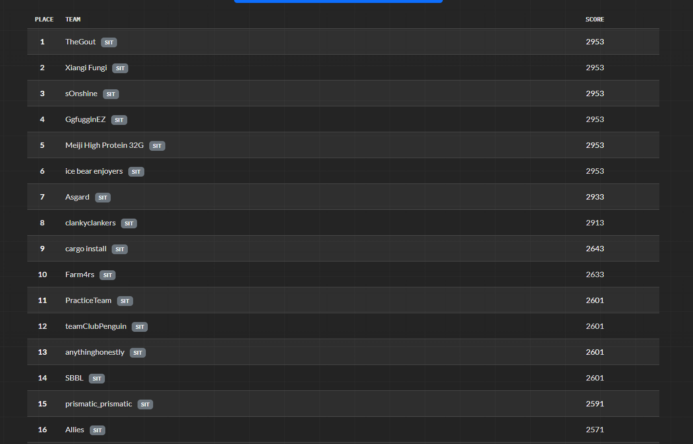
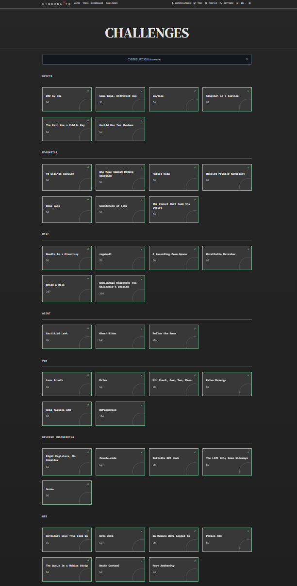
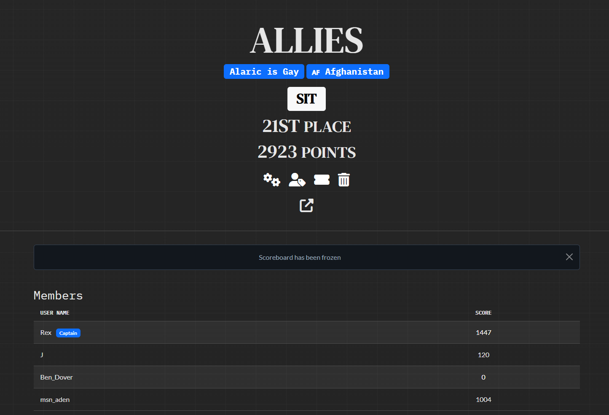

# CYBERBLITZ 2026 — CTF Writeups

Writeups for challenges from **CYBERBLITZ 2026** (`ctf.cyberh4ts.com`), a Mobile-Legends-themed
CTF. Flag format is `CYBLTZ2026{...}` — with one documented exception noted below.

Published after the event ended.

## Team

**Allies** — competing in the SIT category. **16th place, 2,571 points** on the frozen
scoreboard; **21st place, 2,923 points** once the freeze lifted.

| Member |
|---|
| ZR |
| JK |
| Aden |
| Alaric |

The team solved more than is documented here. This repository collects the challenges ZR
worked.

## Solved

| # | Challenge | Category | Flag |
|---|---|---|---|
| 2 | [Same Kopi, Different Cup](writeups/crypto/same-kopi-different-cup.md) | Crypto | `CYBLTZ2026{54m3_571ck_n3w_r3c31pT}` |
| 5 | [94 Seconds Earlier](writeups/forensics/94-seconds-earlier.md) | Forensics | `CYBLTZ2026{d47e29ac836f10b2}` |
| 9 | [Roam Logs](writeups/forensics/roam-logs.md) | Forensics | `CYBLTZ2026{LAYLAROAMS}` |
| 13 | [ragebait](writeups/misc/ragebait.md) | Misc | `CYBLTZ2026{n0t_go04_3nou6h_m4t3}` |
| 21 | [Lean Proofs](writeups/pwn/lean-proofs.md) | Pwn | `CYBLTZ2026{2b0c52a2c9d9136c46de9217e44b4633928b8cf9}` |
| 22 | [Prims](writeups/pwn/prims.md) | Pwn | `CYBLTZ2026{c10aafab...4b768d}` |
| 23 | [ROP2Impress](writeups/pwn/rop2impress.md) | Pwn | `CYBLTZ2026{5b7a9a9e...8fb813c2}` |
| 24 | [Eight Registers, No Compiler](writeups/rev/eight-registers.md) | Reverse | `CYBLTZ2026{31gh7_r3G5_0n3_v01c3}` |
| 25 | [fraude-code](writeups/rev/fraude-code.md) | Reverse | `CYBLTZ2026{please_bro_just_ten_more_subagents___...}` |
| 26 | [Infinite GPA Hack](writeups/rev/infinite-gpa-hack.md) | Reverse | `CYBLTZ2026{inf1n1t3_gp4_gl1tch}` |
| 28 | [Snake](writeups/rev/snake.md) | Reverse | `CYBLTZ2026{s1mplyth000n}` |
| 29 | [Container Says This Side Up](writeups/web/container-says-this-side-up.md) | Web | `CYBLTZ2026{534L3d_f13ld5_571ll_5h1p}` |
| 31 | [Gate Zero](writeups/web/gate-zero.md) | Web | `CYBLTZ2026{0ffL1n3_b04rd_n3v3r_f0rg07}` |
| 33 | [No Humans Were Logged In](writeups/web/no-humans-were-logged-in.md) | Web | `CYBLTZ2026{s3rv1c3_4cc0un75_l34v3_hum4n_5h4D0w5}` |
| 35 | [The Queue Is a Mobius Strip](writeups/web/mobius-strip.md) | Web | `CYBLTZ2026{d0ubL3_d3c0d3_5k1pp3d_7h3_l1n3}` |
| 41 | [Follow the Roam](writeups/osint/follow-the-roam.md) | OSINT | `CYBLITZ2026{T1GrE4l_P4qU1t0}` ⚠️ |
| 44 | [Berth Control](writeups/web/berth-control.md) | Web | `CYBLTZ2026{r3D1r3c7_ch3ck3d_0nly_0nc3}` |
| 51 | [Prims Revenge](writeups/pwn/prims-revenge.md) | Pwn | `CYBLTZ2026{bee9662e5540ba718cc648f996613261}` |

⚠️ **Follow the Roam uses the `CYBLITZ` prefix** (extra `I`), unlike every other flag in the
event. `CYBLTZ2026{T1GrE4l_P4qU1t0}` is rejected by the scoreboard. This looked like an author
typo in the challenge text but is in fact the accepted flag.

## Not solved (analysis notes published anyway)

| # | Challenge | Category | How far it got |
|---|---|---|---|
| 17 | [Whack-a-Mole](writeups/misc/whack-a-mole.md) | Misc | Protocol + forensic tooling built, detection unreliable |
| 48 | Heap Karaoke 2AM | Pwn | Released late; not attempted |

These are included because the dead ends are often more instructive than the wins — see
especially the [lessons learned](LESSONS.md) writeup on how a 2-frame video insert defeated
~16,000 frames of OCR.

## Repository layout

```
writeups/
  crypto/      same-kopi-different-cup.md
  forensics/   94-seconds-earlier.md  roam-logs.md
  misc/        ragebait.md  whack-a-mole.md
  osint/       follow-the-roam.md
  pwn/         lean-proofs.md  prims.md  prims-revenge.md  rop2impress.md
  rev/         eight-registers.md  fraude-code.md  infinite-gpa-hack.md  snake.md
  web/         berth-control.md  container-says-this-side-up.md  gate-zero.md
               mobius-strip.md  no-humans-were-logged-in.md
tools/         reusable scripts produced while solving
LESSONS.md     post-mortem: what worked, what didn't, and why
```

## Proof

Scoreboard at the freeze — Allies in 16th:



The team's challenge board at the end of the event (green = solved):



Final team page after the freeze lifted — 21st place, 2,923 points, with the per-member split:



Every category was cleared except four: Whack-a-Mole and Unreliable Narrator: The Collector's
Edition (misc), Heap Karaoke 2AM (pwn) and Port Authority (web).
